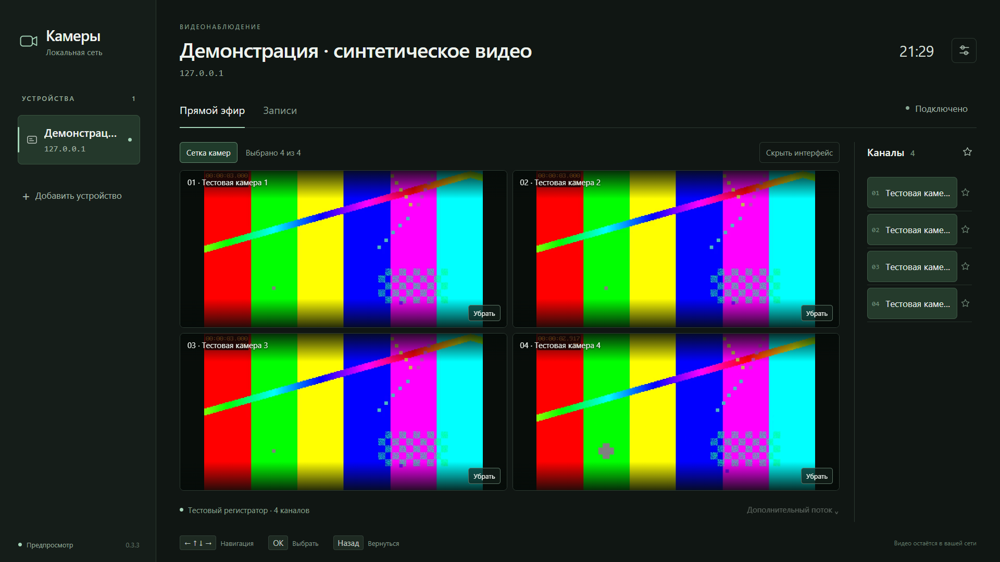
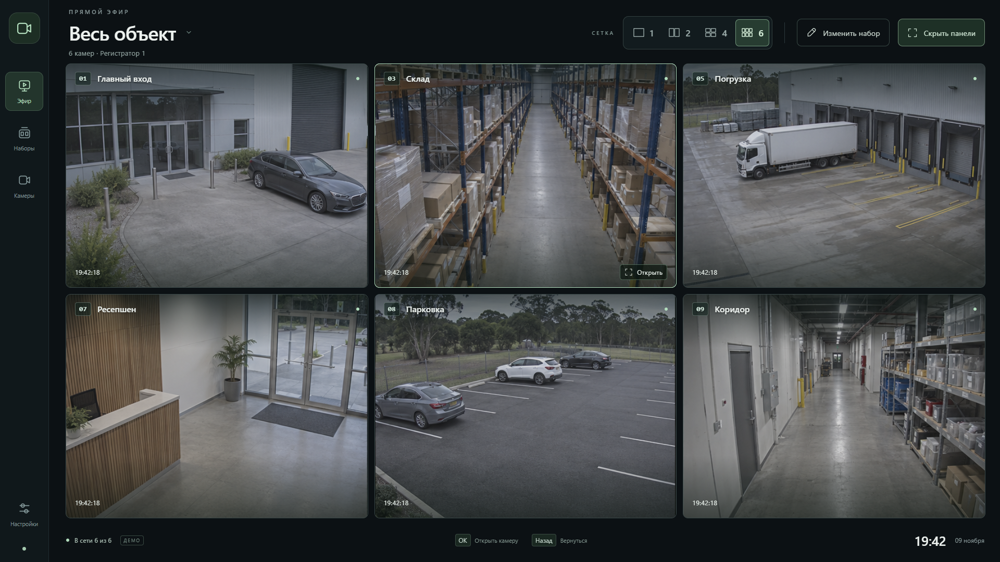

# LG XMEye Viewer

**An open-source CCTV viewer for LG webOS TVs: local DVRIP connections, H.264/H.265 playback and up to four simultaneous cameras.**

[Русский](README.md) · [Installation](docs/INSTALL.en.md) · [Compatibility](docs/COMPATIBILITY.md) · [Privacy](docs/PRIVACY.md) · [Issues](https://github.com/alexbel123/lg-xmeye-viewer/issues/new/choose)

The TV application and its JavaScript service connect directly to an XMEye-compatible DVR/NVR by IP, using the recorder's own account. An always-on computer and an XMEye cloud account are not required. Cloud/P2P login by serial number is not implemented.

**Experimental developer preview, version 0.3.3.** [The release](https://github.com/alexbel123/lg-xmeye-viewer/releases/tag/v0.3.3) includes HD/FHD IPK packages, a source-built decoder bundle, full corresponding sources and checksums. The decoder is built from pinned FFmpeg sources. This project has not been approved for LG Content Store. Ordinary non-root Developer Mode operation has not yet been validated. Read compatibility notes before installation.

## Features

- Separate recorder profiles and encrypted saved credentials per device.
- Live channel list, main/substream selection and hot camera switching.
- Up to **four** live cameras from one recorder, with independent media connections.
- Fullscreen camera field with hidden controls and remote navigation.
- H.264/H.265 playback using MediaSource or a local WebAssembly/WebGL decoder.
- Recording search/playback, verified against synthetic recordings.
- HD/FHD layouts, remote scrolling and preserved video aspect ratio.

No audio, PTZ, cloud-serial login, recording export or universal recorder compatibility. The hardware MP4 path rejects reordered B-frames.

## Screenshots

Working application with **synthetic test patterns**, never private CCTV footage:



Separate v0.4 **UI concept**, with generated images. Its 1/2/4/6 layouts and named camera sets are design proposals and are not all implemented in the working application:



Open `design/prototype-v0.4/index.html` for the interactive concept. It makes no connections to recorders.

## Get started

Follow [installation](docs/INSTALL.en.md) and [compatibility](docs/COMPATIBILITY.md). The first run contains no configured devices. Add your recorder's address, port and viewing account, then select a channel or the camera grid. Grid mode uses the Extra1 substream.

The TV needs a routed network connection to the recorder. Separate subnets work only when routing and access rules permit the connection. XMEye cloud connectivity on a phone does not establish this local route.

## Development

Requirements: Git, Node.js 18+, Python 3.10+; FFmpeg for media tests.

```sh
git clone https://github.com/alexbel123/lg-xmeye-viewer.git
cd lg-xmeye-viewer
python tools/vendor-decoder.py
npm start
```

Open http://127.0.0.1:19428. The preview server binds to loopback and is intended for local development. `tools/vendor-decoder.py` installs this project's source-built decoder from its GitHub release and verifies archive/file SHA-256; downloaded binaries are not tracked in this repository.

On Windows run `python tools/install-test-ffmpeg.py`. On Linux install FFmpeg or set `FFMPEG` to its executable path. Run `npm test` and `npm run check:publication`. The bundled video fixtures are generated FFmpeg test patterns. `node test/fixture-recorder.cjs` starts a loopback-only fake recorder on port 19429, with test-only credentials `test-viewer` / `synthetic-fixture-only`.

## Validation and privacy

Historical v0.3.1 hardware verification on an LG OLED65C2RLA covered four HEVC 800×448 streams for 45 seconds and six hot switches. This is limited evidence, not a claim of continuous operation or compatibility with every TV. See [sanitized results](verification.json) and [CI](https://github.com/alexbel123/lg-xmeye-viewer/actions).

No personal recorder profiles, private IP/MAC addresses, credentials, local logs or real CCTV footage are included. Saved password hashes are sensitive authentication material. See [privacy](docs/PRIVACY.md), [contributing](CONTRIBUTING.md) and [security reporting](SECURITY.md).

## License

Project source: **GPL-3.0-only**. Commercial use is allowed subject to the license. Third-party components retain their own licenses. See [LICENSE](LICENSE), [licensing scope](docs/LICENSING.md) and [third-party notices](THIRD_PARTY_NOTICES.txt). Full decoder sources and build scripts are supplied alongside binary releases. To rebuild on Linux/WSL: `python tools/build-decoder.py` (Python 3.12+ and build-essential), then `npm run test:decoder`. See [decoder build](decoder/README.md).

This is an independent interoperability project, not an official LG or XMEye application. Product names belong to their respective owners.
