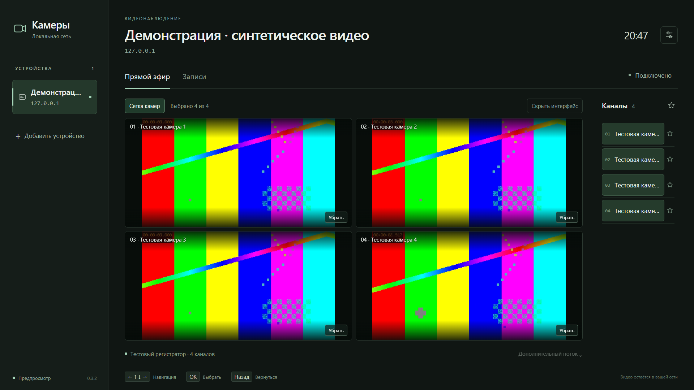
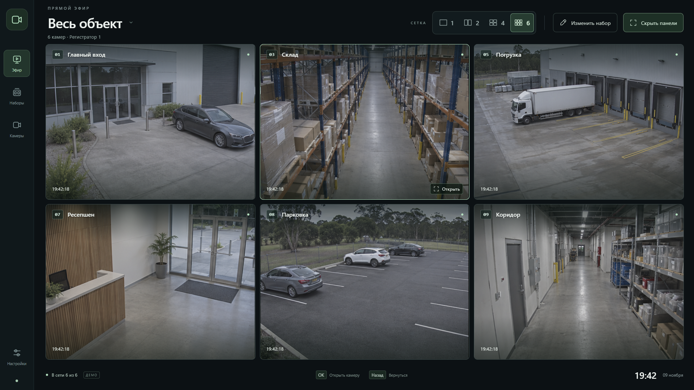

# LG XMEye Viewer

**Камеры видеонаблюдения на телевизоре LG webOS: подключение к регистратору по локальной сети, H.264/H.265 и до четырёх камер одновременно.**

[](https://github.com/alexbel123/lg-xmeye-viewer/actions/workflows/checks.yml)
[](LICENSE)
[](https://github.com/alexbel123/lg-xmeye-viewer/releases)

[English](README.en.md) · [Установка](docs/INSTALL.ru.md) · [Совместимость](docs/COMPATIBILITY.md) · [Конфиденциальность](docs/PRIVACY.md) · [Сообщить об ошибке](https://github.com/alexbel123/lg-xmeye-viewer/issues/new/choose)

Независимый открытый клиент для XMEye-совместимых DVR/NVR. Интерфейс и сервис работают на телевизоре; постоянно включённый компьютер для просмотра не нужен. Приложение подключается по IP и использует учётную запись самого регистратора. Облачный аккаунт XMEye не требуется и не поддерживается.

**Статус: ранняя версия с открытыми исходниками.** Это публикация на GitHub; одобрения LG Content Store пока нет. В первом публичном выпуске доступны исходники и инструкция самостоятельной сборки. Готовые IPK и бинарные декодеры не распространяются до проверки полноты их соответствующих исходников. Работа обычной установки Developer Mode без root ещё не подтверждена — см. [ограничения](docs/COMPATIBILITY.md).

## Что уже работает

- Несколько профилей регистраторов, отдельные сохранённые данные входа для каждого.
- Получение списка каналов и прямой эфир через DVRIP, обычно TCP 34567.
- Горячее переключение камер с отдельными управляющим и видеосоединениями.
- До **четырёх** выбранных камер одного регистратора одновременно.
- Скрытие интерфейса для просмотра поля камер на весь экран.
- Управление стрелками, OK, «Назад», указателем Magic Remote и CH+/CH−.
- Основной и дополнительный потоки, H.264 и H.265/HEVC.
- Поиск и воспроизведение записей: проверены на синтетическом стенде.
- Интерфейс HD/FHD с сохранением пропорций видео и прокруткой форм с пульта.

Нет звука, PTZ, облачного подключения по серийному номеру, экспорта записей и поддержки всех моделей регистраторов. Аппаратный MP4-путь не восстанавливает временные метки B-кадров. Подробности — в [таблице совместимости](docs/COMPATIBILITY.md).

## Как выглядит приложение

Рабочая сетка с **синтетическим тестовым видео**; реальные камеры и пользовательские данные в изображение не включены:



Развиваемый интерфейс v0.4: **это отдельный интерактивный макет**, все кадры сгенерированы. Сетки 1/2/4/6 и подписанные наборы показаны в макете; в рабочей версии ограничение — четыре потока, наборы пока не перенесены:



Макет можно открыть локально: `design/prototype-v0.4/index.html`. Он не подключается к регистраторам. [Описание макета](design/prototype-v0.4/README.md).

## Начать пользоваться

1. Проверьте [модель телевизора, тип подключения и ограничения](docs/COMPATIBILITY.md).
2. Следуйте [инструкции сборки и установки на LG](docs/INSTALL.ru.md).
3. При первом запуске нажмите **«Добавить устройство»**. Готовых адресов и учётных записей в приложении нет.
4. Введите IP, порт и данные отдельной учётной записи регистратора с правами просмотра.
5. Выберите канал или откройте «Сетку камер». Для сетки используется дополнительный поток Extra1.

Телевизор должен иметь сетевой маршрут к регистратору. Разные подсети допустимы при настроенной маршрутизации и правилах доступа. Облачный P2P-доступ XMEye эти условия не заменяет.

## Быстрый запуск для разработчика

Нужны Git, Node.js 18+ и Python 3.10+. Для видеотестов также нужен FFmpeg.

```sh
git clone https://github.com/alexbel123/lg-xmeye-viewer.git
cd lg-xmeye-viewer
python tools/vendor-decoder.py
npm start
```

Откройте **http://127.0.0.1:19428**. Это локальный предпросмотр для разработки. Сервер слушает только loopback; он не предназначен для публикации в интернете. На Windows тестовый FFmpeg можно установить командой `python tools/install-test-ffmpeg.py`; на Linux используйте системный `ffmpeg` или переменную `FFMPEG`.

```sh
npm test
npm run check:publication
```

Синтетический регистратор: `node test/fixture-recorder.cjs` (loopback, порт 19429). Тестовые значения `test-viewer` / `synthetic-fixture-only` относятся только к этому стенду. Не используйте их на реальных устройствах. [Разработка и вклад](CONTRIBUTING.md).

## Приватность и проверка

Пароли, их служебные хеши, IP/MAC-адреса домашних устройств, локальные журналы и личные видеозаписи в репозиторий не входят. Первый запуск начинается с пустого списка устройств. Сохранённые данные входа шифруются сервисом отдельно для каждого профиля; хеш пароля также считается секретом. [Какие данные хранятся и где](docs/PRIVACY.md).

Историческая проверка версии 0.3.1 на LG OLED65C2RLA: четыре HEVC-потока 800×448 одновременно в течение 45 секунд и шесть переключений без потери подключения. Это ограниченная проверка на конкретном оборудовании. Она не доказывает круглосуточную стабильность или совместимость со всеми LG. [Обезличенные результаты](verification.json), [текущие автоматические проверки](https://github.com/alexbel123/lg-xmeye-viewer/actions).

## Лицензия и участие

Код проекта — **GNU GPL v3.0 only**. Коммерческое использование допустимо при соблюдении лицензии. У сторонних компонентов сохраняются собственные лицензии; [область распространения](docs/LICENSING.md) и [уведомления](THIRD_PARTY_NOTICES.txt) описаны отдельно.

Ошибки и предложения принимаются через [Issues](https://github.com/alexbel123/lg-xmeye-viewer/issues). Уязвимости — через [приватное сообщение GitHub Security](https://github.com/alexbel123/lg-xmeye-viewer/security/advisories/new). В отчёты не добавляйте пароли, хеши, серийные номера и реальные адреса устройств.

LG, webOS и XMEye — обозначения соответствующих правообладателей. Проект не является официальным приложением LG или производителя XMEye.
